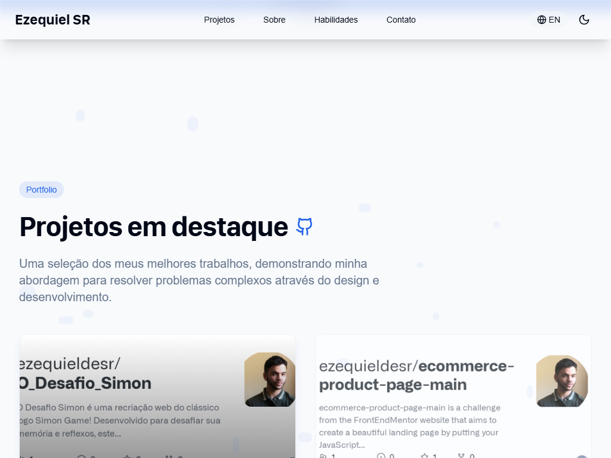
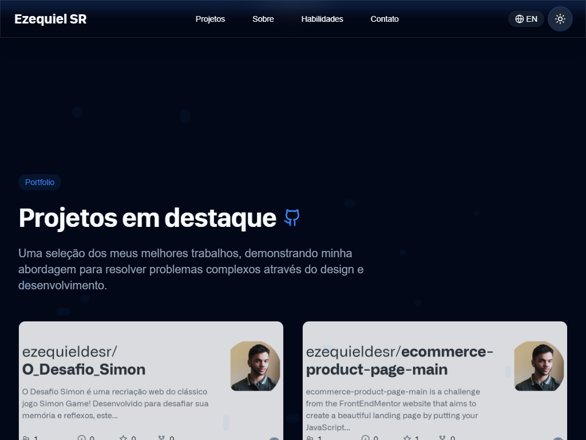

# Ezequiel SR · Portfólio profissional

[](https://github.com/ezequieldesr/dynamic-portfolio-nova/actions/workflows/ci.yml)
[Ver site](https://dynamic-portfolio-nova.vercel.app) · [Demonstração](docs/demo/portfolio-demo.mp4) · [Material Fiverr](docs/fiverr/PUBLICAR-NA-FIVERR.md)


Portfólio pessoal para apresentar projetos, competências e experiência, com contato direto.
Criado em **14 de abril de 2025**, com React, TypeScript, Vite, Tailwind CSS e componentes shadcn/ui.
A base inicial foi criada com Lovable; este repositório contém as personalizações e a evolução do projeto.

## Explore os recursos

- Navegação por Projetos, Sobre, Habilidades e Contato, com rolagem suave.
- Temas claro e escuro, compartilhados entre os controles e salvos no navegador.
- Conteúdo em português e inglês, com preferência persistida.
- Cards com links para código-fonte e demonstrações externas.
- Download do currículo em PDF.
- Layout responsivo e menu móvel com fechamento por Escape.
- Formulário com integração EmailJS opcional e alternativa de contato por e-mail.

<details>
<summary>Ver mais telas</summary>





</details>

## Execute localmente

Requisitos: **Node.js 24** e npm. Este projeto é somente frontend: não precisa de Java, backend ou banco de dados.

```bash
git clone https://github.com/ezequieldesr/dynamic-portfolio-nova.git
cd dynamic-portfolio-nova
npm ci
npm run dev
```

Acesse http://127.0.0.1:8084. Use `npm run build` e `npm run preview` para conferir a versão de produção.

### Contato por EmailJS

Sem configuração, o site funciona e apresenta contato por e-mail; o botão de envio fica desabilitado.
Para habilitá-lo, copie `.env.example` para `.env.local`, configure os três identificadores públicos do
EmailJS e reinicie o Vite. O template precisa aceitar `name`, `email`, `subject` e `message`.
Configure a lista de domínios autorizados, quotas e proteção contra abuso no painel do EmailJS.
Variáveis `VITE_` são públicas no JavaScript gerado: nunca coloque senhas ou chaves privadas nelas.

## Verifique as alterações

```bash
npm run lint
npm run typecheck
npm run build
npx playwright install chromium
npm run test:e2e
```

Os testes iniciam o preview automaticamente na porta 8084. Execute-os sem configuração do EmailJS;
a pipeline já define os identificadores como vazios e não envia mensagens reais.
Para recriar as capturas e o vídeo local: `npm run demo:record` (após o build).
O roteiro está em [docs/ROTEIRO-DEMONSTRACAO.md](docs/ROTEIRO-DEMONSTRACAO.md).

## Publicação e manutenção

Na Vercel: framework Vite, comando `npm run build`, saída `dist`, Node.js 24.
Adicione os identificadores públicos do EmailJS somente se quiser ativar o formulário.
O arquivo `vercel.json` configura fallback de rotas e headers de segurança.
Alterações locais só chegam ao site após commit, push e deploy.

GitHub Actions verifica lint, TypeScript, build e testes de navegador. CodeQL e Dependency Review
complementam a revisão; Dependabot propõe atualizações. Veja [CI e segurança](docs/CI-SEGURANCA.md).
Os testes não comprovam entrega real de e-mail nem disponibilidade dos sites externos dos projetos.
